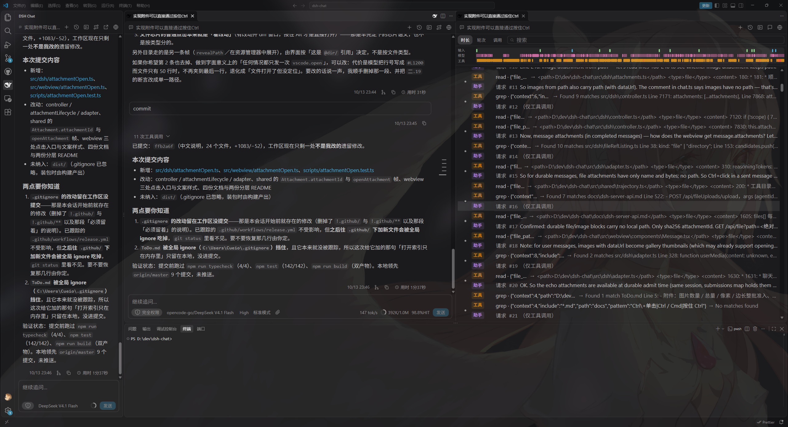

# DSH Chat



在 VS Code 中使用 [DeepSeek Harness](https://github.com/deepseek-ai/deepseek-harness)（`dsh`）的第三方前端。扩展自绘 webview，不嵌入官方网页；会话、模型与工具能力由 DSH 提供，数据语义与官方 Web UI 对齐。

[English](#english) | 简体中文

## 安装

先安装 DSH `npm i -g @deepseek-ai/dsh` 或 [DSH 桌面端](https://www.deepseek.com/harness/) ，并按首次使用引导配置模型凭据。

扩展可从 [VSCode 扩展市场](https://marketplace.visualstudio.com/items?itemName=Lin515.dsh-chat) 直接安装，如需源码打包：

```bash
npm install
npm run package  # Releases/dsh-chat-<version>.vsix
```

然后请从扩展设置中配置连接方式，共有三种连接 DSH 的方式：内部DSH、外部DSH、桌面端DSH，分别对应配置项：`dshChat.command`、`dshChat.url`、`dshChat.desktopExecutable`，需启用哪一种方式，则配置哪一项即可。

## 连接

开启 `dshChat.autoConnect` 时，扩展启动后自动连接**一次**，选路为：

| 条件 | 行为 |
|---|---|
| 内部 DSH 已运行 | 连接扩展托管的守护进程与内部 DSH，自动取得启动令牌 |
| 内部未运行、外部可达 | 连接 `dshChat.url`；需要授权时输入启动 URL 的 `?token=` 值，也可用 VSCode 命令「DSH: 输入访问令牌」 |
| 内部未运行、外部不可达、DSH 桌面端的内置服务可连接 | 接入 DSH 桌面端**已经在内置运行**的那套服务，继续它正开着的会话 |
| 以上均不可用 | 按`dshChat.command`启动内部 DSH，若`dshChat.command`为空，则会以`dshChat.desktopExecutable`启动 DSH 桌面端。 |

- 在内部 DSH 模式下，相同启动命令的 VS Code 窗口共用后台；最后一个窗口断开后默认空闲 10 秒才退出。在此宽限期内重载不会中断后台。

## DSH 桌面端

桌面端（Electron 应用）自己内置运行着一套 DSH 服务，扩展直接接入它，不另起第二套 `dsh web`。

- `dshChat.desktopExecutable` 指向桌面端可执行文件（机器作用域）；留空则整条支路关闭。两边必须用**同一个 DSH 主目录**，否则凭据会被拒。

## 配置

| 键 | 默认 | 作用 |
|---|---|---|
| `dshChat.url` | `http://127.0.0.1:3080` | 外部 DSH 地址 |
| `dshChat.command` | `dsh web --port 0 --no-open` | 内部 DSH 的启动命令，原样执行，不追加参数；留空 = 不使用内部 DSH |
| `dshChat.desktopExecutable` | 空 | DSH 桌面端可执行文件路径，需与桌面端使用同一个 DSH 主目录（如果没有特别配置过 DSH 主目录，那么默认就是满足的） |
| `dshChat.supervisorIdleSec` | `10` | 内部 DSH 在无 VSCode 窗口连接后的退出宽限期，5–600 秒 |
| `dshChat.autoConnect` | `true` | 启动时自动连接，无可用连接时自动启动服务 |
| `dshChat.diffLayout` | `auto` | 编辑 diff：窄单栏 / 宽双栏，或固定 `unified` / `split` |
| `dshChat.language` | `auto` | 聊天语言：跟随 VS Code，或 `zh-cn` / `en` |
| `dshChat.fontSize` | `0` | 整数 px；`0` 跟随 VS Code，非零值最小 8 px，基准为 13px。字体会直接使用设定值，整个界面会根据设定值与基准值的比例进行缩放 |
| `dshChat.questionBatch` | `3` | 问卷一次展开的题数；超出时依次问答，`0-1` 即总是展开 |
| `dshChat.turnProcessThreshold` | `5` | 结束后的过程段达到该工具数才折叠；含子代理派发；`0` 不折，`1–2` 总是折叠，不过单个调用仍平铺 |
| `dshChat.agentPreset` | 空 | 新会话预设 id 或中英文显示名；空值使用服务端默认预设 |

## 使用

### 面板与会话

- 可在活动栏、辅助侧栏或编辑器中使用。命令「DSH: 在编辑器中打开对话」与活动栏头部按钮将对话开到已有编辑器分组；编辑器标题栏的鲸鱼按钮在当前分组新建会话

- 历史列表只显示当前工作区的会话，支持新建、归档、删除。
- 可从会话具体节点分支，分支标题带「分支: 」前缀。
- 有子代理时点击标题可展开顶层会话与多层子代理树，切换任意层级；标题后显示当前会话的子代理数，一次性子代理只读，可继续子代理支持续聊。
- 后台任务抽屉分两个分区：**自动化任务**（模型用 `schedule_create` 安排的定时任务，显示频率与下次运行，可展开看执行记录、修改运行时间、删除）与**后台任务**（bash / pwsh 等，可展开看实时输出）。抽屉里有后台任务在跑、或还有待执行的自动化任务时，顶栏那颗入口按钮会亮起（有任务真的在跑时还会呼吸；只是排着时不闪）。
- 轨迹提供账本、时间线与详情检查器。
- 如需进行服务端设置，可通过「在浏览器中打开」进入官方 Web UI；当前连的是桌面端内置服务时那颗按钮改为「打开 DSH 桌面端」（那套服务不向浏览器开放）。

### 消息通知

需要关注、又未在会话中明确呈现的信息会进入通知队列：红色表示影响会话执行的错误，黄色表示非阻断问题，绿色表示重要变化。顶部优先显示最新未确认项，必须点击「确认」才会移入历史，不会自动消失；确认只表示知悉。

通过「展开历史」或命令「DSH: 查看消息通知」打开通知抽屉。每个视图只显示当前会话与共享通知，确认会同步到同窗口的其他视图。未确认的同类通知合并计数，确认后再次发生会重新提醒。已确认历史最多保留 500 条，未确认通知不自动淘汰；通知仅保存在扩展宿主内存中，重开面板或切换会话不会清除，重载窗口或退出 VS Code 后清空。

### 输入、引用与附件

- `/` 打开命令与技能菜单；`@` 引用文件、目录或历史会话，写入 `@path`、`@dir/` 或 `@[标题](dsh-session:…)`，由模型自行读取，不占附件通道。
- 目录行主体进入目录，右侧「整个目录」按钮引用目录；键盘用 Enter 引用、Tab 进入。已发送的引用直接点击；草稿引用按住 `Ctrl` 点击。会话引用在新标签页打开，沿用编辑器分组规则。
- `Alt+Shift+2` 将编辑器选区加入为 `@path#L12-L40` 引用。
- 回形针选择文件：图片发送为内容块，其余文件上传，芯片显示上传状态。此路径通道不受拖放的 8 MB 限制。
- 拖放须按住 `Shift`：文件走字节通道，单文件最多 8 MB，不支持目录。Windows 复制文件或目录后粘贴可由宿主取回真路径：文件走附件、目录变成正文引用；其它平台与截图粘贴回退到同一字节通道。纯文本粘贴不变。粘贴进来的图片按会话内序号命名（中文界面 `图1.png`、英文界面 `image1.png`），编号只增不回收，便于在对话里直接指代。
- 图片另受服务端准入限制：单张不超过 20 MiB、宽 × 高不超过 64,000,000 像素、单边不超过 8192，一条消息最多 20 张且合计不超过 200 MiB（默认值，可配置）。进不了内容块的图片不会被当成图片发送，而是**作为文件上传**（内容寻址的只读副本，远端部署下模型也能用工具处理它）：逐图超限的副本模型需先缩小才能直接查看，张数或总量超出的副本模型可直接读取。提示报的是上限（像素按「6400万」这类缩写），不会只说「太大了」。
- 用户、模型与工具返回的图片，以及交付或本轮生成的图片文件均可预览。正文本地图片仅在会话工作目录内读取；HTTPS 图片不发送 referrer。点击看原图，`Esc` 关闭。

### 生成与交互

工具行可展开完整参数、结果与结构化 diff，运行时显示耗时。审批、问卷和计划审阅有专属卡片；问卷可放弃整组回答。未被图片、菜单或编辑操作消费的 `Esc` 停止当前轮；队列非空时会按原序重发待发消息。

界面提供中英双语、上下文占用、目标条与轮次导航。窗口布局与会话身份存于 VS Code 工作区缓存，不写入项目；消息记录从 DSH 恢复，展开状态保留在界面内存中，不保证跨重载恢复。Markdown 支持任务列表、表格与脚注，不提供公式渲染或代码高亮。

## 开发与验证

先读 [AGENTS.md](AGENTS.md)。设计与契约入口见 [docs/README.md](docs/README.md)，测试与诊断入口见 [scripts/README.md](scripts/README.md)。构建使用 Node 24.22.1（见 `.nvmrc`）。常规验证不调用模型：

```bash
npm run typecheck
npm test
npm run build
```

`npm run preview` 预览 webview；`npm run package` 打包。`smoke`、真实探针与 e2e 会启动 DSH 或调用模型，运行前须取得用户当次明确批准。

## 已知限制

- 无协议版本协商；当前核对基准与兼容边界见 [dsh-compat.md](docs/dsh-compat.md)。
- 接入桌面端内置服务依赖桌面端与 `dsh-client-connection` 的内部实现（凭据记录、`dsh-desktop-host` 的入口与 spawn 形态），已登记在 [dsh-compat.md](docs/dsh-compat.md)，随官方版本对拍。
- 停止刻意采用「摘空队列 → cancel → 按原序重发」：历史实测中只 cancel 不可靠地接续队列。
- 生成中的正文会重建 DOM，点击文件链接可能被增量刷新吞掉；轮次结束后再点。后台任务的 ANSI 着色与部分官方统计展示尚未实现。
- 自动化任务：只列**当前会话**的任务（全局任务页、会话头部的提醒时钟、`schedule_create` 的对话卡片与「活跃指示」尚未实现）；本扩展对 `cron` 显示规范表达式本身，不渲染官方那句自然语言描述。删除是硬删（执行记录一并消失），且不会取消已经在途的那一次投递。
- 拖放受 VS Code iframe 门控与字节通道限制；其它平台的大文件请用回形针，目录请用 `@`。
- 面板恢复依赖 VS Code 工作区缓存与 `window.restoreWindows`。

## 许可与归属

[MIT](LICENSE)。来源与取舍详见 [THIRD-PARTY-NOTICES.md](THIRD-PARTY-NOTICES.md)：协议类型来自 DeepSeek Harness，传输层结构继承自 DeepSeek-Harness-for-VS-Code；早期视觉参考 Continue，未复制其源码。

---

<a id="english"></a>

# DSH Chat

A third-party VS Code frontend for [DeepSeek Harness](https://github.com/deepseek-ai/deepseek-harness) (`dsh`). It draws its own webview rather than embedding the official page. DSH supplies sessions, models and tools; data semantics follow the official Web UI.

## Install

Install DSH with `npm i -g @deepseek-ai/dsh` or the [DSH desktop app](https://www.deepseek.com/harness/), and follow its first-use credential setup.

Install the extension directly from the [VS Code Marketplace](https://marketplace.visualstudio.com/items?itemName=Lin515.dsh-chat), or build from source:

```bash
npm install
npm run package  # Releases/dsh-chat-<version>.vsix
```

Then configure the connection method in the extension settings. DSH can be connected in three ways — internal DSH, external DSH and the desktop app — configured by `dshChat.command`, `dshChat.url` and `dshChat.desktopExecutable` respectively; set only the one you want to use.

## Connection

With `dshChat.autoConnect` enabled, the extension connects automatically **once** after startup:

| Condition | Action |
|---|---|
| Internal DSH is running | Connect to the extension-managed supervisor and internal DSH; obtain the launch token automatically |
| No internal DSH, external is reachable | Connect to `dshChat.url`; when required, enter the launch URL's `?token=` value, or use the VS Code command **DSH: Enter Access Token** |
| No internal DSH, external unreachable, the DSH desktop app's built-in service is attachable | Attach to the service the desktop app **already runs**, continuing the sessions it has open |
| None of the above | Start internal DSH using `dshChat.command`; if it is empty, launch the DSH desktop app using `dshChat.desktopExecutable`. |

- In internal DSH mode, VS Code windows with the same launch command share a backend. It exits after the last connection has been idle for 10 seconds by default; reloading within that grace period leaves it running.

## DSH desktop app

The desktop app (Electron) already runs a DSH service of its own, and the extension attaches to it instead of starting a second `dsh web`.

- `dshChat.desktopExecutable` points at the app's executable (machine-scoped); empty disables the branch. Both sides must use the **same DSH home**, otherwise the credential is rejected.

## Settings

| Key | Default | Purpose |
|---|---|---|
| `dshChat.url` | `http://127.0.0.1:3080` | External DSH address |
| `dshChat.command` | `dsh web --port 0 --no-open` | Internal DSH launch command, executed verbatim without extra arguments; empty means no internal DSH |
| `dshChat.desktopExecutable` | empty | Path of the DSH desktop app executable; both sides must use the same DSH home (the default is fine unless you have customised it) |
| `dshChat.supervisorIdleSec` | `10` | Exit grace period for internal DSH once no VS Code window is connected, 5–600 seconds |
| `dshChat.autoConnect` | `true` | Connect at startup; start the service automatically when no connection is available |
| `dshChat.diffLayout` | `auto` | Narrow unified / wide split diff, or fixed `unified` / `split` |
| `dshChat.language` | `auto` | Follow VS Code, or use `zh-cn` / `en` |
| `dshChat.fontSize` | `0` | Integer px; `0` follows VS Code, nonzero values are at least 8 px, baseline 13px. The font uses the value directly and the whole UI scales by its ratio to the baseline |
| `dshChat.questionBatch` | `3` | Number of questions expanded together; larger sets run sequentially, `0-1` always shows all |
| `dshChat.turnProcessThreshold` | `5` | Fold a finished process segment at this many tool calls, including subagent dispatches; `0` never folds, `1–2` always folds, single-call segments stay flat |
| `dshChat.agentPreset` | empty | New-session preset id or Chinese/English display name; empty uses the server default |

## Use

### Panels and sessions

- Use the activity bar, secondary sidebar or editor area. **DSH: Open in Editor** and the activity-bar header button open a conversation in an existing editor group; the whale button in the editor title bar creates a session in the current group.
- History is scoped to the current workspace and supports new, archive and delete.
- You can branch from a specific session node; branch titles have a “Branch: ” prefix.
- Click the title when subagents exist to expand the top-level session and the multi-level subagent tree and switch across any level; the count after the title shows how many subagents the current session has. One-shot agents are read-only, continuable agents support follow-up chat.
- The jobs drawer has two sections: **Scheduled tasks** (scheduled by the model through `schedule_create`, showing frequency and next run, with expandable execution records, rescheduling and deletion) and **Background jobs** (bash / pwsh and similar jobs, with expandable live output). The header button lights up while a background job is running or a scheduled task is pending; it pulses only while something is actually running, not just scheduled.
- Trajectory provides a ledger, timeline and inspector.
- To change server-side settings, use **Open in browser** to reach the official Web UI; while attached to the DSH desktop app's built-in service that button becomes **Open DSH Desktop App** instead, because that service is not exposed to browsers.

### Notifications

Important information not already shown clearly in the conversation enters the notification queue: red for errors blocking session execution, yellow for non-blocking issues, and green for important changes. The newest unacknowledged item stays at the top until you explicitly acknowledge it; acknowledgment means awareness, not resolution.

Open the notification drawer with **Show history** or **DSH: View Notifications**. Each view shows its current session and shared notifications, with acknowledgments synchronized across views in the same window. Repeated unacknowledged items are grouped and counted; recurrence after acknowledgment creates a new item. Up to 500 acknowledged items are retained; unacknowledged items are never evicted automatically. Notifications stay only in extension-host memory: reopening panels or switching sessions keeps them, while reloading the window or exiting VS Code clears them.

### Input, references and attachments

- `/` opens commands and skills; `@` references files, folders or past sessions using `@path`, `@dir/` or `@[title](dsh-session:…)`. The model reads references itself; they are not attachments.
- A folder row navigates into it; its “Entire folder” button references it. Enter references, Tab navigates. Click references in sent messages directly; hold `Ctrl` to click draft references. Session links open a new tab using the same editor-group rules.
- `Alt+Shift+2` inserts an editor selection as `@path#L12-L40`.
- The paperclip sends images as content blocks and uploads other files, showing upload status on their chips. This path channel is not subject to the drop channel's 8 MB cap.
- Hold `Shift` to drop files. Drops use bytes, allow up to 8 MB per file and do not support folders. On Windows, pasting copied files/folders retrieves their paths: files become attachments, folders become text references. Other platforms and pasted screenshots use the same byte channel. Plain-text paste is unchanged. Pasted images are named by session order (`图1.png` in the Chinese interface, `image1.png` in the English one); numbers only grow and are never reused, so you can refer to an image by name in the conversation.
- Images are also subject to server admission limits: at most 20 MiB each, 64,000,000 pixels (width × height), 8192 per side, and 20 images per message totalling at most 200 MiB (defaults; configurable). An image over a limit is never sent as an image; it is **uploaded as a file** instead (a content-addressed read-only copy the model can process with tools even on a remote deployment). A copy that broke a per-image limit must be downscaled before the model can view it, while one that only broke the count or total-byte limit can be read directly. Messages state the limit (pixel counts are abbreviated, e.g. 64M) rather than just "too large".
- Preview images from users, models, tools, deliverables and files generated this turn. Local answer images are read only inside the session working directory; HTTPS images send no referrer. Click for the original; `Esc` closes it.

### Generation and interaction

Expand tool rows for full arguments, results and structured diffs; running tools show elapsed time. Approvals, questionnaires and plan reviews have dedicated cards, and a questionnaire can be abandoned as a group. An `Esc` not consumed by an image, menu or edit stops the turn; queued messages are then resent in their original order.

The UI offers Chinese/English, context usage, goals and turn navigation. Window layout and session identity are cached per workspace by VS Code, not written to project files. Message history is restored from DSH; expansion state is held in UI memory and is not guaranteed to survive a reload. Markdown supports task lists, tables and footnotes, but not math rendering or code highlighting.

## Development

Read [AGENTS.md](AGENTS.md) first. See [docs/README.md](docs/README.md) for designs and contracts, and [scripts/README.md](scripts/README.md) for tests and diagnostics. Builds use Node 24.22.1 (see `.nvmrc`). Routine validation makes no model calls:

```bash
npm run typecheck
npm test
npm run build
```

Use `npm run preview` for the webview and `npm run package` for a VSIX. Smoke tests, live probes and e2e may start DSH or call models; obtain explicit user approval for each invocation.

## Limitations

- No protocol version negotiation; see [dsh-compat.md](docs/dsh-compat.md) for the current checked baseline and compatibility boundaries.
- Attaching to the desktop app's built-in service relies on internal implementations of the app and of `dsh-client-connection` (the credential record, and the `dsh-desktop-host` entry and spawn shape); they are registered in [dsh-compat.md](docs/dsh-compat.md) and checked against new upstream versions.
- Stop intentionally drains the queue, cancels and resends in order: historical probes did not reliably resume queued work after a bare cancel.
- Streaming text rebuilds its DOM, so an incremental update may swallow a file-link click; retry after the turn ends. ANSI coloring for background jobs and some upstream statistics remain unimplemented.
- Scheduled tasks: only the **current session's** tasks are listed (the global tasks page, the session-header reminder clock, the `schedule_create` conversation card and its activity indicator are not implemented); `cron` is shown as the expression itself rather than as the upstream natural-language description. Deletion is hard (execution records go with it) and does not cancel a delivery already in flight.
- Drops are constrained by VS Code's iframe gate and the byte channel. On other platforms, use the paperclip for large files and `@` for folders.
- Panel restoration depends on VS Code's workspace cache and `window.restoreWindows`.

## Licence and attribution

[MIT](LICENSE). See [THIRD-PARTY-NOTICES.md](THIRD-PARTY-NOTICES.md) for sources and design choices: protocol types come from DeepSeek Harness; transport structure derives from DeepSeek-Harness-for-VS-Code; early visuals referenced Continue without copying its source.
